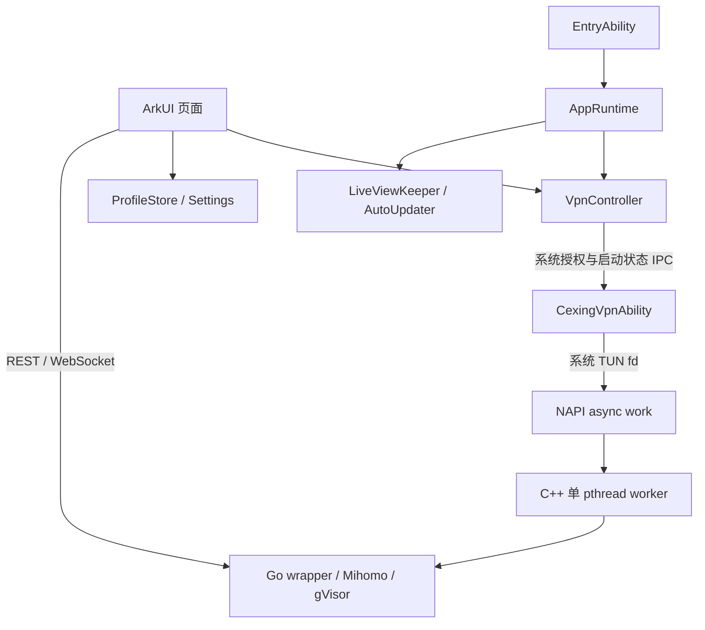

# 架构与职责

## 现有运行边界

VPN Extension 持有系统 VPN 连接；NAPI worker 将 Go 调用移到专用线程。系统与 Go 侧分别管理原 fd 和复制 fd。ArkUI 不拥有 TUN 或 Go runtime。

| 模块 | 单一职责 |
|---|---|
| `EntryAbility` | 应用启动、加载窗口、通知运行时前台事件 |
| `AppRuntime` | 进程级状态监听、后台任务、订阅调度与自动恢复 |
| `VpnController` | 系统授权、路由与应用名单、扩展连接、启动状态 |
| `CexingVpnAbility` | TUN 创建、进程网络保护、资源铺盘、内核启动与清理 |
| `ProfileStore` / `Settings` | 应用私有配置文件、来源元数据、激活选择及偏好 |
| `CoreApi` | 原生 HTTP/WS 控制面客户端 |
| `LiveViewKeeper` | 长时任务、实况窗更新、任务事件及有界重申请 |
| `AutoUpdater` | 按设置检查激活订阅来源并更新 |
| `core/` / `cpp/` | 内核配置、平台适配、C ABI 和调用线程 |

原生入口为连接、配置、设置。配置保留 URL/文件/剪贴板导入及编辑；网络与内核设置保留实际平台能力。代理组页只从运行内核读取信息，供 Zashboard 接入前选择手动组节点，不解析另一套离线 YAML 数据模型。

## 生命周期约束

页面的流量 WS 与状态监听随页面释放；后台保活和订阅调度随 VPN 状态运行。关闭页面不能隐式调用 VPN stop。Connecting/Disconnecting 期间保留后台运行资源，Disconnected 才释放。后台任务启动、停止和取消清理串行执行，迟到的旧任务事件按任务身份过滤，避免旧停止清理新会话。

扩展 `onConnect` 及时返回 IPC 对象，异步初始化完成后报告就绪。取消启动要先撤销系统 VPN，再回收迟到的内核启动。普通启动的 Connected 表示扩展报告就绪，实际网络健康仍须流量验证；冷启动 `recover` 在 Controller 探活后只读绑定现有扩展，核对同一会话的 TUN 创建与内核就绪再恢复状态；不重新创建 TUN。运行时定期核对会话身份及控制面响应，失联时展示故障；这些观测仍不能替代真实转发验证。未确认停止或未核实的绑定阻止新启动，首页提供“重试断开”。当前绑定的清理用本次 IPC 请求的应答确认，空会话 ID 也不能借旧文件回执宣称成功；失联后只读重绑并重试停止，迟到应答不自动清除未知状态。

Ability 重建时为后台服务重新绑定上下文，订阅定时器读取最新上下文，不重复创建定时器。显式用户启停和 VPN 状态变化使待执行的自动恢复失效；超时前再次检查最新恢复偏好。

## 目标边界

Zashboard 承担节点、策略组、连接、日志、规则和 Smart 管理；原生宿主只承担系统、订阅、状态与故障恢复。配置生成统一经过平台约束，控制面共享一个端口与认证来源。详细要求见 [配置](reference/configuration.md)、[组件集成](reference/integrations.md)。

`VpnController.cancelRecovery()` 使在途恢复结果与回调失效；`AppRuntime.cancelRestore()` 同时取消定时恢复。显式启停、当前 Ability 销毁及新恢复意图都须拒绝旧结果，旧 Ability 销毁不能撤销新上下文。页面销毁不能停止已建立的 VPN。
